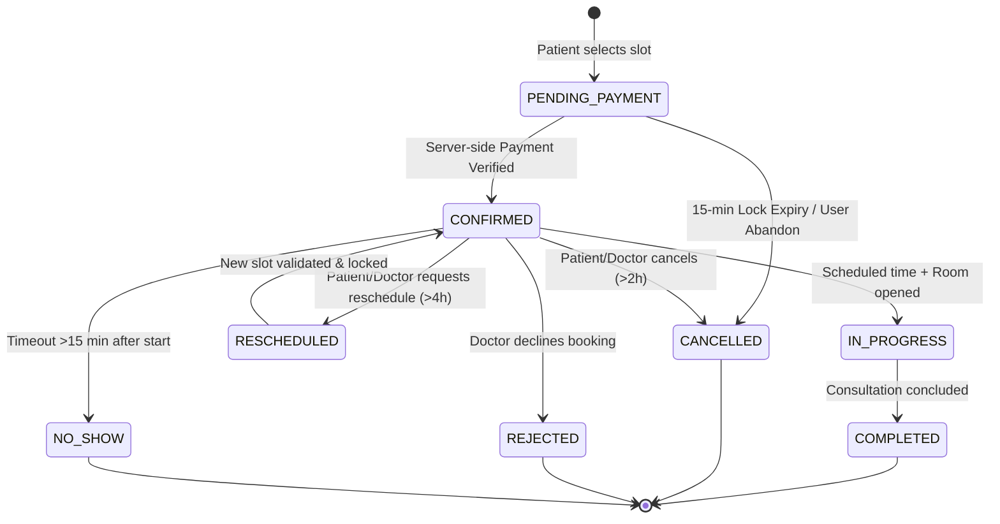
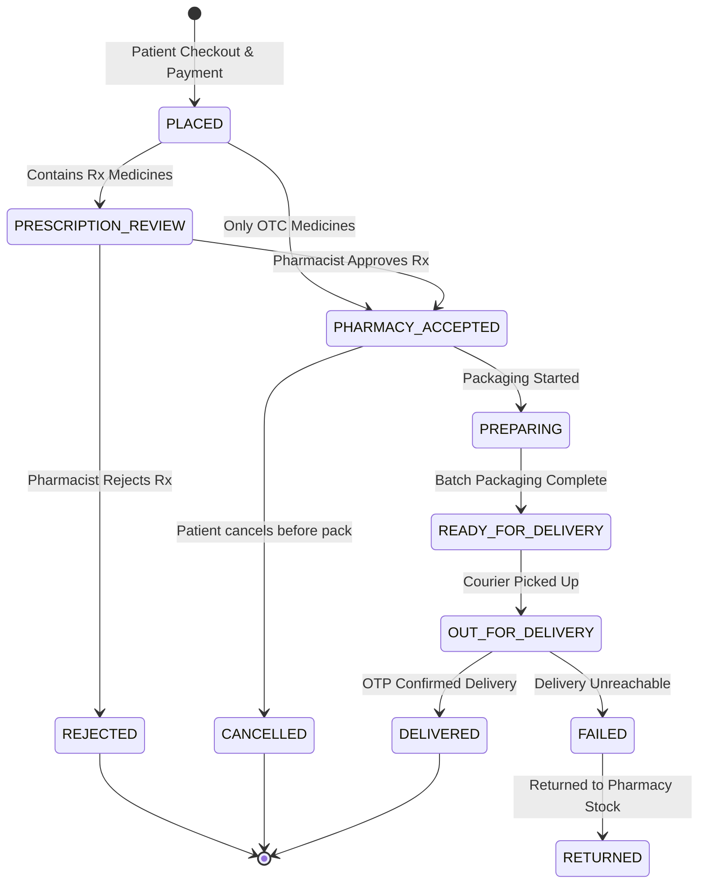

# LifeLine Domain State Machines & Lifecycle Specifications

> **Document Version:** 1.0  
> **Status:** Phase 5 Approved Baseline  
> **Scope:** Formal State Machines, Transition Matrices, Preconditions, Guards, and Automated Side Effects

---

## 1. Appointment State Machine

The **Appointment** represents the temporal agreement/booking between a Patient and a Doctor.

### 1.1 States
* `PENDING_PAYMENT`: Initial state when slot is selected and temporary reservation lock (15 minutes) is placed.
* `CONFIRMED`: Payment verified server-side; slot permanently booked on doctor's calendar.
* `RESCHEDULED`: Date/time shifted to a new slot with both parties notified.
* `IN_PROGRESS`: Appointment time has arrived and consultation room is active.
* `COMPLETED`: Medical consultation has concluded; consultation notes/prescription linked.
* `CANCELLED`: Appointment cancelled by patient or doctor prior to the session.
* `REJECTED`: Doctor actively declined the requested appointment.
* `NO_SHOW`: Patient or doctor failed to join within 15 minutes of scheduled start.

### 1.2 Transition Matrix

| Source State | Trigger Event | Destination State | Authorized Actor | Preconditions / Guards | Side Effects & Events |
|:---|:---|:---|:---|:---|:---|
| `[*] ` | `SELECT_SLOT` | `PENDING_PAYMENT` | `PATIENT` | Doctor verified; slot free; no existing conflicting appointment | Create temporary 15-min reservation lock; generate Payment Order |
| `PENDING_PAYMENT` | `PAYMENT_VERIFIED` | `CONFIRMED` | `SYSTEM` (Webhook) | Gateway signature valid; payment amount matches fee exactly | Commit slot index; emit `APPOINTMENT_CONFIRMED`; send email/SMS; notify Doctor |
| `PENDING_PAYMENT` | `LOCK_EXPIRED` | `CANCELLED` | `SYSTEM` (Cron/Job) | 15 minutes elapsed without payment | Release slot lock; void payment intent; notify Patient |
| `CONFIRMED` | `REQUEST_RESCHEDULE` | `RESCHEDULED` | `PATIENT`, `DOCTOR` | Current time < `scheduledStart - 4h`; new slot is available | Atomic shift to new slot; notify counterpart; emit `APPOINTMENT_RESCHEDULED` |
| `CONFIRMED` | `CANCEL` | `CANCELLED` | `PATIENT`, `DOCTOR`, `ADMIN` | Current time < `scheduledStart - 2h` (for patient) | Release calendar slot; initiate refund via payment provider; emit `APPOINTMENT_CANCELLED` |
| `CONFIRMED` | `DOCTOR_REJECT` | `REJECTED` | `DOCTOR` | Reason provided; appointment not yet in progress | Release slot; initiate 100% automated refund; notify Patient; audit log |
| `CONFIRMED` | `START_SESSION` | `IN_PROGRESS` | `DOCTOR`, `SYSTEM` | Scheduled time window reached (`scheduledStart - 5min` to `scheduledEnd`) | Create Consultation entity; emit `CONSULTATION_ROOM_OPENED` |
| `CONFIRMED` | `MARK_NO_SHOW` | `NO_SHOW` | `SYSTEM` (Job) | `scheduledStart + 15min` reached and neither party joined | Log audit record; doctor payout policy evaluated; notify parties |
| `IN_PROGRESS` | `END_SESSION` | `COMPLETED` | `DOCTOR` | Consultation ended; notes/summary submitted | Emit `APPOINTMENT_COMPLETED`; unlock review submission; notify Patient |

---

## 2. Consultation State Machine

The **Consultation** tracks the real-time clinical interaction (video, audio, or chat) between Doctor and Patient. It is decoupled from the Appointment entity.

### 2.1 States
* `SCHEDULED`: Initial state instantiated once appointment is confirmed.
* `ROOM_OPENED`: Doctor has initiated the virtual consultation room.
* `IN_CONSULTATION`: Both participants have joined and media streams are active.
* `PAUSED`: Temporary disconnection or network interruption.
* `ENDED`: Live call disconnected by participants or timer expiration.
* `COMPLETED`: Clinical documentation (notes, diagnosis, prescription) finalized by doctor.

### 2.2 Transition Matrix

| Source State | Trigger Event | Destination State | Authorized Actor | Preconditions / Guards | Side Effects & Events |
|:---|:---|:---|:---|:---|:---|
| `SCHEDULED` | `INITIATE_ROOM` | `ROOM_OPENED` | `DOCTOR` | Current time within appointment window (`start - 5m`) | Request video session token from provider; emit `ROOM_READY` to Patient |
| `ROOM_OPENED` | `PATIENT_JOINED` | `IN_CONSULTATION` | `PATIENT` | Valid room token; room open | Start consultation timer; emit `PARTICIPANT_JOINED`; activate chat socket |
| `IN_CONSULTATION` | `NETWORK_DISCONNECT` | `PAUSED` | `SYSTEM` (Socket) | Socket disconnect detected | Start 5-minute reconnect grace window; notify counterpart |
| `PAUSED` | `RECONNECT` | `IN_CONSULTATION` | `PATIENT`, `DOCTOR` | Reconnection within grace window | Resume session timer; emit `PARTICIPANT_RECONNECTED` |
| `IN_CONSULTATION` | `HANGUP` | `ENDED` | `DOCTOR`, `PATIENT` | Minimum 1 minute duration elapsed | Close video session room; record total duration; notify Doctor to complete notes |
| `PAUSED` | `GRACE_EXPIRED` | `ENDED` | `SYSTEM` | 5 minutes disconnected | Close session; mark partial completion; log audit event |
| `ENDED` | `SUBMIT_CLINICAL_NOTES` | `COMPLETED` | `DOCTOR` | Attending doctor; consultation summary provided | Transition parent Appointment to `COMPLETED`; enable digital prescription issuing |

---

## 3. Prescription State Machine

The **Prescription** entity represents the legal digital medical order for drugs and instructions issued by a verified Doctor.

### 3.1 States
* `DRAFT`: Doctor is composing the prescription; items can be edited/removed.
* `FINALIZED_ISSUED`: Doctor has digitally signed and issued the prescription. **Immutable.**
* `FULFILLED_PARTIAL`: Part of the prescribed medication has been dispensed by a pharmacy.
* `FULFILLED_COMPLETE`: All prescribed items have been fully dispensed.
* `EXPIRED`: Prescription has passed its validity window (standard: 90 days).
* `REVOKED`: Doctor or Admin revoked the prescription due to clinical revision or error.

### 3.2 Transition Matrix

| Source State | Trigger Event | Destination State | Authorized Actor | Preconditions / Guards | Side Effects & Events |
|:---|:---|:---|:---|:---|:---|
| `[*] ` | `CREATE_DRAFT` | `DRAFT` | `DOCTOR` | Active or completed consultation exists | Initialize draft; link patient and consultation ID |
| `DRAFT` | `ISSUE_PRESCRIPTION` | `FINALIZED_ISSUED` | `DOCTOR` | Contains >=1 medication; diagnosis present; valid registration | Generate immutable PDF snapshot; sign cryptographically; emit `PRESCRIPTION_ISSUED` |
| `FINALIZED_ISSUED` | `DISPENSE_PARTIAL` | `FULFILLED_PARTIAL` | `PHARMACY` | Verified pharmacy; stock dispensed for a subset of items | Decrement remaining allowable quantity; emit `PRESCRIPTION_PARTIALLY_DISPENSED` |
| `FINALIZED_ISSUED` / `FULFILLED_PARTIAL` | `DISPENSE_ALL` | `FULFILLED_COMPLETE` | `PHARMACY` | All medication items fully dispensed | Mark prescription closed for further dispensing; audit log |
| `FINALIZED_ISSUED` | `TTL_EXPIRED` | `EXPIRED` | `SYSTEM` (Cron) | `issuedAt + 90 days` < current date | Invalidate prescription for new pharmacy orders; emit `PRESCRIPTION_EXPIRED` |
| `FINALIZED_ISSUED` | `REVOKE` | `REVOKED` | `DOCTOR`, `ADMIN` | Clinical justification provided; reason logged | Flag invalid; immediately cancel any pending pharmacy orders using it; notify Patient |

---

## 4. Medicine Order State Machine

The **Order** entity handles pharmacy medicine purchases, prescription verification, packaging, and delivery.

### 4.1 States
* `PLACED`: Order created and paid (or COD selected); awaiting pharmacy intake.
* `PRESCRIPTION_REVIEW`: Pharmacist is verifying the attached prescription for Rx items.
* `PHARMACY_ACCEPTED`: Pharmacy confirmed inventory availability and prescription validity.
* `PREPARING`: Pharmacy is packaging and bagging the order batches.
* `READY_FOR_DELIVERY`: Package sealed; awaiting courier pickup.
* `OUT_FOR_DELIVERY`: Handed over to logistics courier; in transit.
* `DELIVERED`: Delivered to patient delivery address; confirmed by delivery code.
* `CANCELLED`: Order cancelled by patient prior to pharmacy processing.
* `REJECTED`: Pharmacy rejected order (e.g. invalid prescription, out of stock).
* `FAILED`: Delivery attempt permanently failed (incorrect address, customer unreachable).
* `RETURNED`: Medication returned to pharmacy.

### 4.2 Transition Matrix

| Source State | Trigger Event | Destination State | Authorized Actor | Preconditions / Guards | Side Effects & Events |
|:---|:---|:---|:---|:---|:---|
| `[*] ` | `CHECKOUT` | `PLACED` | `PATIENT` | Payment confirmed; stock reserved | Emit `ORDER_PLACED`; notify Pharmacy; reserve inventory items |
| `PLACED` | `ROUTE_REVIEW` | `PRESCRIPTION_REVIEW` | `SYSTEM` | Order contains >=1 `prescriptionRequired: true` item | Notify Pharmacist to review attached prescription |
| `PLACED` | `AUTO_ACCEPT_OTC` | `PHARMACY_ACCEPTED` | `SYSTEM` / `PHARMACY` | Order contains ONLY OTC drugs | Notify Pharmacy packaging team; emit `ORDER_ACCEPTED` |
| `PRESCRIPTION_REVIEW` | `PHARMACY_APPROVE_RX` | `PHARMACY_ACCEPTED` | `PHARMACY` | Pharmacist verifies validity of prescription match | Emit `PRESCRIPTION_VERIFIED`; record pharmacist license in audit |
| `PRESCRIPTION_REVIEW` | `PHARMACY_REJECT_RX` | `REJECTED` | `PHARMACY` | Rejection reason specified | Release stock reservation; trigger 100% automated refund; notify Patient |
| `PHARMACY_ACCEPTED` | `START_PACKAGING` | `PREPARING` | `PHARMACY` | Batch numbers assigned | Decrement actual stock permanently; print order invoice |
| `PREPARING` | `SEAL_PACKAGE` | `READY_FOR_DELIVERY` | `PHARMACY` | Packaging completed; tracking label generated | Notify logistics service; emit `ORDER_READY_FOR_PICKUP` |
| `READY_FOR_DELIVERY` | `COURIER_PICKUP` | `OUT_FOR_DELIVERY` | `PHARMACY`, `SYSTEM` | Courier code scanned | Generate delivery confirmation OTP; send SMS/Notification to Patient |
| `OUT_FOR_DELIVERY` | `CONFIRM_OTP` | `DELIVERED` | `COURIER`, `SYSTEM` | Valid delivery OTP submitted | Emit `ORDER_DELIVERED`; release pharmacy escrow payout; audit log |
| `PLACED` / `PHARMACY_ACCEPTED` | `PATIENT_CANCEL` | `CANCELLED` | `PATIENT` | Order not yet in `PREPARING` state | Release stock reservation; trigger automated refund; emit `ORDER_CANCELLED` |

---

## 5. Payment State Machine

The **Payment** entity tracks all financial transactions for appointments and medicine orders.

### 5.1 States
* `CREATED`: Payment intent / order initialized on backend.
* `PENDING_GATEWAY`: Client has opened payment modal with provider token.
* `PROCESSING`: Webhook received from provider indicating capture in progress.
* `SUCCESS`: Cryptographic server-side webhook / verification validated. **Finalized.**
* `FAILED`: Gateway declined transaction (insufficient funds, 3DS failed).
* `REFUND_PENDING`: Refund requested by cancellation/rejection; submitted to gateway.
* `REFUNDED`: Gateway confirms credit back to customer source account.
* `EXPIRED`: Checkout abandoned after 15 minutes without payment attempt.

### 5.2 Transition Matrix

| Source State | Trigger Event | Destination State | Authorized Actor | Preconditions / Guards | Side Effects & Events |
|:---|:---|:---|:---|:---|:---|
| `[*] ` | `INITIALIZE_INTENT` | `CREATED` | `SYSTEM` (Internal) | Order or Appointment in valid initial state | Register intent with Razorpay/Stripe; obtain `providerOrderId` |
| `CREATED` | `MODAL_OPENED` | `PENDING_GATEWAY` | `CLIENT` | Valid order token | Track client attempt |
| `PENDING_GATEWAY` | `WEBHOOK_CAPTURE` | `PROCESSING` | `SYSTEM` (Webhook) | Gateway webhook received | Begin idempotent verification transaction |
| `PROCESSING` / `PENDING_GATEWAY` | `VERIFY_SUCCESS` | `SUCCESS` | `SYSTEM` (Backend) | Cryptographic signature matches gateway secret; amount exact match | Trigger parent entity confirmation (Appointment -> `CONFIRMED`, Order -> `PLACED`); emit `PAYMENT_SUCCESS` |
| `PENDING_GATEWAY` | `GATEWAY_FAILURE` | `FAILED` | `SYSTEM` (Webhook) | Gateway failure payload | Unlock reserved slot/stock; notify Patient; record failure reason |
| `CREATED` / `PENDING_GATEWAY` | `EXPIRY_TIMER` | `EXPIRED` | `SYSTEM` (Cron) | 15 minutes elapsed without callback | Release checkout lock; mark payment expired |
| `SUCCESS` | `INITIATE_REFUND` | `REFUND_PENDING` | `SYSTEM` (Cancellation) | Appointment or Order cancelled within refund window | Call gateway refund API; generate refund tracking ID |
| `REFUND_PENDING` | `REFUND_CONFIRMED` | `REFUNDED` | `SYSTEM` (Webhook) | Gateway confirms credit settlement | Emit `REFUND_COMPLETED`; notify customer; record ledger entry |

---

## 6. Doctor Credential Verification Workflow

Doctors cannot accept appointments or conduct consultations until administratively verified.

### 6.1 States
* `UNSUBMITTED`: Registered account with basic profile; verification documents pending.
* `PENDING_REVIEW`: Credentials and license documents submitted; in admin queue.
* `INFO_REQUESTED`: Admin flagged discrepancies and requested additional documents.
* `APPROVED_VERIFIED`: Credentials verified; doctor appears in public search and can accept patients.
* `REJECTED`: Credentials permanently rejected (fraudulent, unrecognized license).
* `SUSPENDED`: Doctor account temporarily suspended (malpractice complaint, audit investigation).

### 6.2 Transition Matrix

| Source State | Trigger Event | Destination State | Authorized Actor | Preconditions / Guards | Side Effects & Events |
|:---|:---|:---|:---|:---|:---|
| `UNSUBMITTED` / `INFO_REQUESTED` | `SUBMIT_CREDENTIALS` | `PENDING_REVIEW` | `DOCTOR` | Required docs (license, degree, ID) uploaded | Place doctor in Admin verification queue; emit `DOCTOR_VERIFICATION_SUBMITTED` |
| `PENDING_REVIEW` | `REQUEST_MORE_INFO` | `INFO_REQUESTED` | `ADMIN` | Explicit feedback message provided | Notify Doctor with admin remarks; provide re-upload access |
| `PENDING_REVIEW` | `APPROVE_DOCTOR` | `APPROVED_VERIFIED` | `ADMIN` | Medical registry validated; admin credentials logged | Set `doctorProfile.verificationStatus = VERIFIED`; enable availability scheduling; emit `DOCTOR_VERIFIED` |
| `PENDING_REVIEW` | `REJECT_DOCTOR` | `REJECTED` | `ADMIN` | Rejection grounds specified | Lock doctor scheduling; notify Doctor; log administrative audit |
| `APPROVED_VERIFIED` | `SUSPEND_DOCTOR` | `SUSPENDED` | `ADMIN` | Disciplinary reason provided | Hide from search; cancel upcoming appointments with full refunds; notify Doctor & patients |
| `SUSPENDED` | `REINSTATE_DOCTOR` | `APPROVED_VERIFIED` | `ADMIN` | Investigation cleared | Re-enable search and scheduling; log audit event |

---

## 7. Pharmacy License Verification Workflow

Pharmacies cannot sell medication or dispense orders until their premises and license are verified.

### 7.1 States
* `UNSUBMITTED`: Registered pharmacy; license documents pending.
* `PENDING_REVIEW`: Retail drug license & owner credentials submitted.
* `LICENSE_VERIFYING`: Admin or regulatory API checking validity against state medical board.
* `APPROVED_VERIFIED`: Verified; pharmacy can list inventory and accept prescription orders.
* `REJECTED`: Application rejected.
* `SUSPENDED`: Suspended due to inventory violation or expired retail license.

### 7.2 Transition Matrix

| Source State | Trigger Event | Destination State | Authorized Actor | Preconditions / Guards | Side Effects & Events |
|:---|:---|:---|:---|:---|:---|
| `UNSUBMITTED` | `SUBMIT_LICENSE` | `PENDING_REVIEW` | `PHARMACY` | Drug license copy, GST, and address proof uploaded | Enqueue in Admin review queue |
| `PENDING_REVIEW` | `BEGIN_VALIDATION` | `LICENSE_VERIFYING` | `ADMIN` | Background review started | Audit log update |
| `LICENSE_VERIFYING` | `APPROVE_PHARMACY` | `APPROVED_VERIFIED` | `ADMIN` | Valid retail license number | Enable inventory catalog, medicine dispensing, and order routing |
| `LICENSE_VERIFYING` | `REJECT_PHARMACY` | `REJECTED` | `ADMIN` | Reason logged | Disallow pharmacy operations |
| `APPROVED_VERIFIED` | `SUSPEND_PHARMACY` | `SUSPENDED` | `ADMIN` | License expired or violation detected | Disable order intake; cancel active unfulfilled orders; notify patients |
